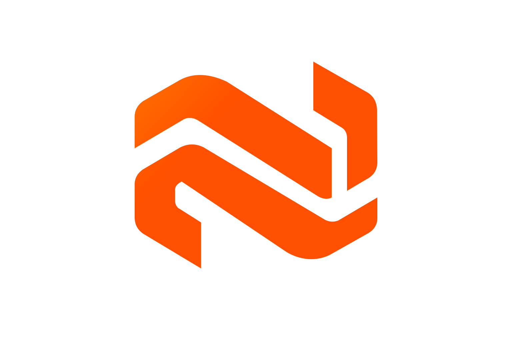

<div align="center"></div>

# NextSSL

**An open, programmable archive of cryptographic algorithms, post-quantum first.** The goal is to become the largest such collection that exists: every algorithm that can be sourced from a trustworthy upstream, reachable by name from Rust, C and any language that can call a C ABI. Today it registers **1028 algorithms** across 24 kinds.

> **Status: early development. Do not use this in production.** There has been no external security audit, nothing here is FIPS validated, the API may change, and no release exists yet. Read [Status](#status-read-this-first) before relying on any algorithm.

## What it is

- **One registry, many algorithms.** Each algorithm lives in its own folder under `algos/<kind>/<family>/<id>/` with an `algo.toml` that records its upstream, pinned version or commit, license, tier, sizes and test vectors. A generator turns those files into the registry tables, the C header and `docs/algo.generated.json`.
- **Post-quantum first.** 173 entries are KEMs and signatures (stateful hash-based ones included), listed next to the classical ones.
- **Breadth over opinion.** Broken and obsolete algorithms are included on purpose (interoperability, research, testing), but they are fenced off by tiers.
- **Nothing hand-written.** Cryptographic cores are copied verbatim from upstream projects. NextSSL's own code is the Rust shell, glue and tooling.

## What is in it

Counts come from [`docs/algo.generated.json`](docs/algo.generated.json).

| Kind | Count | Notes |
|---|---:|---|
| AEAD | 316 | Authenticated encryption, including many CAESAR and NIST lightweight candidates |
| Hash | 164 | Cryptographic hash functions |
| Checksum | 130 | CRCs and Adler/Fletcher-style sums (not cryptographic) |
| Signature | 129 | Digital signatures, post-quantum and classical |
| Block cipher | 61 | Raw block ciphers |
| KEM | 41 | Key encapsulation, post-quantum first |
| Encoding | 28 | Base-N, hex, framing and similar encodings (not cryptographic) |
| MAC | 28 | Message authentication codes |
| Stream cipher | 27 | Stream ciphers |
| PRNG | 26 | Non-cryptographic and statistical generators (not for keys) |
| Block mode | 21 | Modes of operation |
| Password hash | 15 | Memory-hard and slow password hashes |
| Public-key encryption | 9 | Public-key encryption |
| XOF | 8 | Extendable-output functions |
| KDF | 5 | Key derivation |
| Key agreement | 5 | Diffie-Hellman style key agreement |
| Hash-to-curve | 4 | RFC 9380 hash-to-curve suites |
| PAKE | 3 | Password-authenticated key exchange |
| Stateful signature | 3 | Hash-based stateful signatures |
| DRBG | 1 | Deterministic random bit generators |
| OPRF | 1 | Oblivious PRFs |
| RNG | 1 | Operating-system random source |
| Threshold | 1 | Threshold schemes |
| Zero knowledge | 1 | Zero-knowledge proofs |
| **Total** | **1028** | |

**Not all of these are cryptography.** The total includes 130 checksums, 26 non-cryptographic PRNGs and 28 encodings (184 items together). They are in the archive for completeness and as building blocks, and must not be used where security matters. Without them the count is 844.

## Tiers and root access

| Tier | Count | Meaning | Reachable from |
|---|---:|---|---|
| `safe` | 33 | modern, recommended | safe API and root |
| `standard` | 147 | standardised and sound | safe API and root |
| `legacy` | 35 | old but not broken | root only |
| `broken` | 19 | practical attacks exist | root only |
| `research` | 45 | experimental or unclassified | root only |
| `unverified` | 749 | source found, correctness not fully proven | root only |

The **safe API** (`nextssl`) can only reach `safe` and `standard` algorithms and wraps results in self-describing COSE envelopes ([docs/envelope.md](docs/envelope.md)). The **root API** (`nextssl-root`, and `nextssl_root_*` in C) reaches every tier. Using root means you accept the risk of the algorithm you pick: it will hand you MD5, a research KEM or an unproven port. Nothing falls back silently to another algorithm, and every length and parameter is validated with an explicit error.

## How the core is built

```
your code --> Rust shell (validation, tiers, zeroizing keys, envelopes, registry)
                 |-- pinned Rust upstream crates
                 `-- pinned C / C++ upstream sources, compiled by each algorithm's build.rs
                       `-- FFI to C lives only inside the per-algorithm glue
```

- **Rust is the safe shell.** All untrusted input (parsers, envelopes, parameters, lengths) is handled in Rust. `unsafe` is allowed only in `nextssl-ffi` and in the per-algorithm C wrappers.
- **Upstreams are copied, not rewritten.** Each C or C++ core is vendored verbatim in `upstream/` at a pinned commit, with its license file. 609 algorithm folders compile C or C++ through a `build.rs`; the rest use Rust crates. Upstream symbols are renamed with a per-algorithm prefix so no two cores collide, and every export is `nextssl_`-prefixed.
- **Ports are labelled.** When the only trustworthy source is in another language, it may be ported line by line to C. A port is always tier `unverified` and must pass a differential test against the original.
- **Secrets are zeroized** on every exit path, and secret-dependent code is meant to run under constant-time checks.

Crates: `nextssl-core` (traits, errors, tiers), `nextssl-registry` (generated table), `nextssl-compose` (composition engine), `nextssl` (safe API), `nextssl-root` (every tier), `nextssl-ffi` (C ABI) and `nextssl-wasm`.

## Quick start

Build the C ABI library once (`--features everything` adds the copyleft and heavy algorithms):

```bash
cargo build -p nextssl-ffi --release
```

Every binding is a thin layer over that library. Reference: [docs/bindings/c-abi.md](docs/bindings/c-abi.md).

| Language | Example | Guide | Try it |
|---|---|---|---|
| Rust | [`examples/rust/`](examples/rust/) | [rust.md](docs/bindings/rust.md) | `cd examples/rust && cargo run --release -- sha256` |
| Python (ctypes) | [`examples/python/`](examples/python/) | [python.md](docs/bindings/python.md) | `python examples/python/nextssl_demo.py ml-kem-768` |
| JavaScript (Node / WASM) | [`examples/js/`](examples/js/) | [js.md](docs/bindings/js.md) | `node examples/js/nextssl_demo.mjs sha256` |
| Java (FFM) | [`examples/java/`](examples/java/) | [java.md](docs/bindings/java.md) | `cd examples/java && java --enable-native-access=ALL-UNNAMED NextSSLDemo.java sha256` |
| PHP (FFI) | [`examples/php/`](examples/php/) | [php.md](docs/bindings/php.md) | `php -d ffi.enable=1 examples/php/nextssl_demo.php sha256` |
| Swift | [`examples/swift/`](examples/swift/) | [swift.md](docs/bindings/swift.md) | `cd examples/swift && swiftc -O main.swift -o nextssl_demo && ./nextssl_demo sha256` |
| C | `crates/nextssl-ffi/include/nextssl.h` | [c-abi.md](docs/bindings/c-abi.md) | link `libnextssl_ffi` |

Rust, root API (any tier):

```rust
let digest = nextssl_root::md5::hash(b"abc")?;

let (pk, sk) = nextssl_root::ml_kem_768::keygen()?;
let (ct, ss) = nextssl_root::ml_kem_768::encapsulate(&pk)?;
```

Python:

```bash
python examples/python/nextssl_demo.py --list kem
python examples/python/nextssl_demo.py ml-kem-768
python examples/python/nextssl_demo.py --root md5      # non-safe tiers need --root
```

## Composition engine

Constructions are built from parts by name instead of being hard-coded per combination. A composition is a small expression: lowercase names, nested up to four deep, validated before anything runs.

```rust
let mac  = nextssl_root::compose("hmac(sha256)")?;
let mac2 = nextssl_root::compose("hmac(blake3)")?;          // same shape, other hash
let kdf  = nextssl_root::compose("hkdf(sha256)")?;
let pw   = nextssl_root::compose("pbkdf2(hmac(sha256))")?;   // nested
let cmac = nextssl_root::compose("cmac(aes-128)")?;
let cbc  = nextssl_root::compose("cbc(aes-256)")?;
let drbg = nextssl_root::compose("hmac-drbg(sha256)")?;
let pow  = nextssl_root::compose("hashcash(sha256)")?;
```

A name in the wrong slot, an unknown name or an unsupported combination is an explicit error. The `compose-all` feature makes every digest and cipher selectable.

## Verify it yourself

```bash
cargo xtask gen --check          # generated tables, features, json and header are up to date
cargo xtask build-link --check   # C build scripts share one native link directory
cargo xtask check-symbols        # exports are nextssl_*, upstream symbols are prefixed
cargo test --workspace
```

The Docker image adds sanitizers, Miri, fuzzing and WASM builds (`docker build -f docker/Dockerfile.test -t nextssl-test .`). Those layers have **not** been run against every algorithm. Correctness evidence comes from known-answer tests (KATs) taken from published sources such as NIST ACVP, Wycheproof and the designers' own files. "Tested against NIST ACVP vectors" is the only claim made about NIST, and only where an algorithm's KAT file says so.

## Cargo features

| Feature | Effect |
|---|---|
| `copyleft` | Includes GPL/LGPL-family algorithms (7 today). Off by default. |
| `all-heavy` | Algorithms with large dependency trees: `bulletproofs`, `hbs-lms`, `hpke`, `opaque-ke`, `rsa` (each also a feature on its own). |
| `compose-all` | Every digest and cipher in the composition engine. |
| `everything` | (`nextssl-ffi`) `copyleft` plus `all-heavy`. |
| `testing` | (`nextssl-core`) deterministic entropy for KAT runners. Never for releases. |

## Status (read this first)

- **Early development.** Not for production. No external audit. **Not FIPS validated**; no NIST or CMVP certificate is claimed. 96 entries carry a `fips` flag only because the algorithm is specified in a FIPS standard.
- **749 of 1028 algorithms are tier `unverified`** (72%): the source was found and wired, but correctness is not fully proven. They are reachable through the root API only, and only an independent review can lift them out of `unverified`.
- **612 of 1028 algorithms have empty known-answer-test files** (counted from the `kat/` files in each algorithm folder, which contain no vectors). For these, a successful build says nothing about correctness. That includes all 26 PRNGs and all 4 hash-to-curve suites.
- **184 items are not cryptography** (130 checksums, 26 PRNGs, 28 encodings).
- **404 algorithms have no license stated upstream** (recorded as `NOASSERTION`). Check before redistributing.
- **Language examples have not all been run.** They were written against the C ABI, but not every one has been executed against the current algorithm set.
- **Browser WASM is not ready.** The WASM build runs under Node with a small WASI shim. A browser page was loaded in a single Chromium-based browser only; there is no browser test suite.
- **Test layers not run for every algorithm:** sanitizers, Miri, fuzzing, constant-time checks, cross-architecture and differential tests.

## Layout

| Path | Contents |
|---|---|
| `algos/` | 1028 algorithm folders (`algo.toml`, glue, `kat/`, `upstream/`) |
| `algos_parked/` | 31 candidates set aside: not registered, not built |
| `algos_untrusted/` | 6 candidates with unresolved provenance: not registered, not built |
| `crates/` | the Rust shell: core, registry, compose, safe API, root API, FFI, WASM |
| `examples/`, `docs/bindings/` | per-language demos and guides |
| `xtask/` | the generator: `cargo xtask gen`, `check-symbols`, `build-link`, `new` |

## Security

Report vulnerabilities as described in [SECURITY.md](SECURITY.md).

## License

NextSSL's own code is Apache-2.0 ([LICENSE](LICENSE)). **Each algorithm keeps the license of its upstream**, stored in its `upstream/` folder and recorded as an SPDX id in its `algo.toml`. Those licenses differ (MIT, Apache-2.0, BSD, CC0, public domain, GPL-family and others), and some upstream sources state no license at all. Nothing is blocked on license grounds; copyleft algorithms sit behind the `copyleft` feature. Check each algorithm's license before you redistribute.
