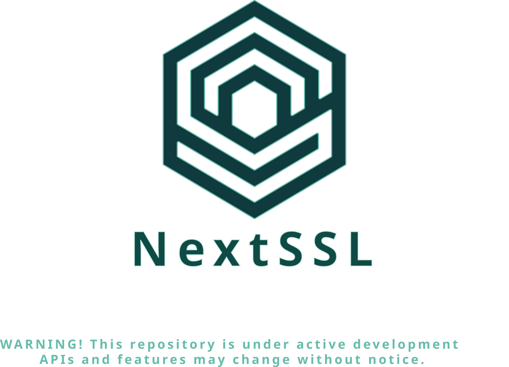

<div align="center"></div>

# NextSSL

A Rust-first cryptographic library under active rebuild. The goal is every crypto-related algorithm, post-quantum first, usable from any language on any platform.

> **Status: early development (phase P0).** Three proof algorithms (SHA-256, BLAKE2b-512, Base64) run end to end. Nothing here is production-ready yet.

- Architecture: [REBUILD_PLAN.md](REBUILD_PLAN.md)
- Algorithm scope: [scope_classification.csv](scope_classification.csv)
- Upstream source references: [docs/reference/](docs/reference/)
- Security reporting: [SECURITY.md](SECURITY.md)

## Build and test

```bash
cargo xtask gen --check
cargo test --workspace
docker build -f docker/Dockerfile.test -t nextssl-test . && docker run --rm nextssl-test
```

## License

Apache-2.0 (see [LICENSE](LICENSE)). Each algorithm keeps its upstream license in `algos/**/upstream/`.
